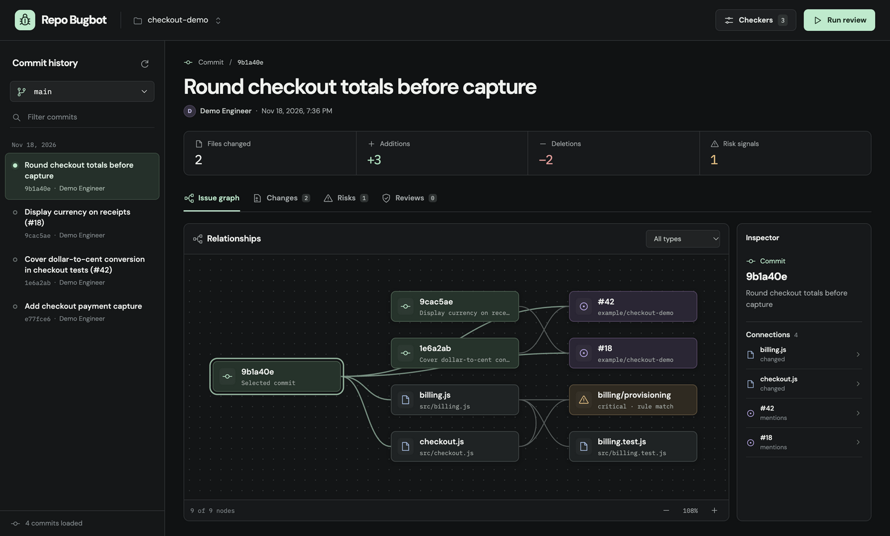
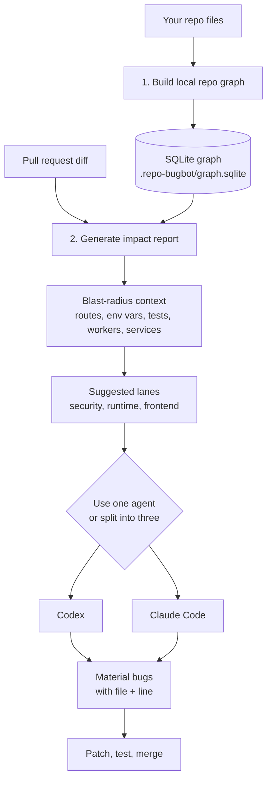

# Free Cursor Bugbot

Explore Git changes locally and run independent reviews with the models you choose.

Free Cursor Bugbot is for developers who like the idea of Cursor Bugbot, but already pay for coding agents like Codex or Claude Code.

Instead of paying for another review bot, Free Cursor Bugbot gives your existing agent the missing context:

- what changed
- what routes, env vars, tests, workers, and services are connected to it
- what production risks the PR touches
- what the agent should review first

Free Cursor Bugbot is independent and not affiliated with Cursor. "Bugbot-style" means PR diff in, blast-radius-aware review context out.

## Desktop app

Open a local Git folder in **Repo Bugbot**. Select a branch and commit to see its changed files, line diffs, risk signals, and issue graph. Click a node to inspect the reason for each connection. The **Reviews** tab keeps the findings, model attribution, and errors for that exact comparison.



Use Git, Python 3.10 or newer, and Node.js 22.12 or newer. From a clone of this repository:

```sh
cd desktop
npm ci
npm start
```

Use `npm start -- --repo /path/to/project` to open a specific repository. `npm run package` builds a desktop application for the current OS and architecture in `desktop/out/`. Packaged apps include the Python backend and use Git and Python from the machine. Set `REPO_BUGBOT_PYTHON` to an absolute interpreter path if necessary.

The graph connects commits with changed files, static risk signals, issue or PR references, and findings reported by the selected review. It also shows supported relative imports and likely tests by file name. For a referenced issue, it looks back through up to 100 earlier commits for the same reference. **Load GitHub details** optionally uses your signed-in GitHub CLI to retrieve its title, state, and references in its description. You can browse commits and run local models offline.

## Run multiple model checkers

Open **Checkers** to choose each reviewer's provider, model ID, name, and focus. A review runs up to three checkers concurrently by default. You can configure one to twelve, including multiple models from one provider. The initial selection uses Codex CLI, Claude Code CLI, and Ollama. Both CLI providers use their existing login. If a desktop launch cannot find a CLI, set `REPO_BUGBOT_CODEX_BIN` or `REPO_BUGBOT_CLAUDE_BIN` to its executable path. Ollama uses a model installed locally.

| Provider | Connection |
| --- | --- |
| Codex CLI, Claude Code CLI | Installed CLI with an active login |
| Ollama, LM Studio | Local model server |
| OpenAI, Google Gemini, OpenRouter | Hosted API with a configurable model ID |
| Anthropic | Messages API |
| Other OpenAI-compatible servers | Choose **OpenAI / compatible** and set the API base URL |

Start a review explicitly to send the committed diff and its context to the selected providers. API credentials come from environment variables available to the app or CLI. Enter the variable **name** in the settings. Graph browsing and Git hooks run locally.

For shell or CI runs, install the Python package in a virtual environment with `python -m pip install .`, then create and edit a checker configuration:

```sh
repo-bugbot-review --init-config /tmp/bugbot-checkers.json
repo-bugbot-review --repo /path/to/project --base origin/main --head HEAD \
  --config /tmp/bugbot-checkers.json --parallel 3
```

Use the actual target branch for `--base`. Without it, the review compares a commit to its first parent, or to an empty tree for the initial commit. The desktop uses this single-commit comparison. All checkers receive the same Git diff and their own focus. The tool records per-checker results and combines matching findings by path, line, and title. A finding is a model's assessment and includes its source checker.

The command prints JSON. Exit **0** means a complete review with no findings, **1** means a complete review with findings, and **2** means incomplete coverage, a provider error, or an invalid configuration. The model input includes up to 60 KB of patch text and 300 changed file summaries. An exceeded limit marks the review incomplete. Local settings and receipts are stored under `~/.repo-bugbot/`, configurable with `REPO_BUGBOT_HOME`. Each receipt is keyed to the repository, base, and head. The desktop and CLI share these settings.

## Manual review quickstart

Clone the tool once:

```bash
git clone https://github.com/samthedataman/free-cursor-bugbot.git
```

Then go to the app repo you want to review:

```bash
cd your-app-repo
python3 -m pip install -e /path/to/free-cursor-bugbot
repo-bugbot-index --repo . --db .repo-bugbot/graph.sqlite
repo-bugbot-impact --repo . --db .repo-bugbot/graph.sqlite --base origin/master --out .repo-bugbot/impact.md
```

Then paste this into Codex or Claude Code:

```text
Read .repo-bugbot/impact.md and git diff origin/master...HEAD.

Review this PR like a strict Bugbot pass. Only report material bugs with file and line references.

Focus on:
- impacted routes
- env vars
- workers/retries
- external writes
- billing/auth
- public UI
- missing tests for risky behavior

Do not report style-only issues.
```

That is the whole local workflow.

## How many agents does the manual workflow start?

Zero by default.

The index and impact commands write these local files. Model calls start when you run `repo-bugbot-review` or click **Run review** in the desktop app.

```text
.repo-bugbot/graph.sqlite
.repo-bugbot/impact.md
.repo-bugbot/impact.json
```

The impact report includes **three suggested review lanes**:

1. Security, billing, and config
2. Runtime, data, and integrations
3. Frontend reachability and UX

You can use it three ways:

- **One agent:** give all of `.repo-bugbot/impact.md` to Codex or Claude Code.
- **Three agents:** split the three suggested review lanes across three Codex/Claude sessions.
- **Human review:** give the report to engineers as a PR review brief.

The simplest setup is one agent. The "three agents" path is optional when you want a heavier review.



## What Cursor Bugbot Does

Cursor Bugbot-style review is useful because it does not just say, "this line looks weird."

The workflow is more like:

1. Look at a pull request.
2. Understand what changed.
3. Guess what could break outside the changed lines.
4. Leave review comments on likely bugs.

That is the right idea. The problem is that many teams already pay for strong agents that can do the review if they are given the right context.

## Why Free Cursor Bugbot Exists

Codex and Claude Code are already good at code review.

What they usually lack is a clean map of the repository:

- which frontend file calls which backend route
- which route depends on which env var
- which worker can retry and duplicate a write
- which tests probably cover the touched code
- which Render service owns a config variable
- which public UI is actually mounted

Free Cursor Bugbot builds that map locally and gives it to the agent.

You are not paying for another brain. You are giving the brain you already pay for better context.

## How It Works

The manual workflow uses two commands.

### 1. Build The Repo Graph

```bash
repo-bugbot-index --repo . --db .repo-bugbot/graph.sqlite
```

This creates a local SQLite database:

```text
.repo-bugbot/graph.sqlite
```

The graph stores:

- files
- imports
- Python and TypeScript symbols
- FastAPI and Express-style routes
- env vars used by code
- Render services and env vars from `render.yaml`
- likely test relationships

Example:

```text
AdminPanel.tsx
  imports -> adminApi.ts

adminApi.ts
  calls -> /api/admin/reports

admin_router.py
  registers -> GET /api/admin/reports
  uses env -> SERVICE_API_KEY

render.yaml
  declares service -> app-api
  declares env -> SERVICE_API_KEY
```

### 2. Generate The PR Impact Report

```bash
repo-bugbot-impact --repo . --db .repo-bugbot/graph.sqlite --base origin/master --out .repo-bugbot/impact.md
```

This looks at the PR diff and asks:

- what files changed?
- what nearby files are connected?
- what env vars or routes were touched?
- what tests are probably relevant?
- is this a billing, auth, webhook, CRM, worker, or public UI risk?

The output is a markdown review brief:

```text
.repo-bugbot/impact.md
```

Give that file to Codex or Claude Code.

## Why This Is Useful

A normal diff review sees:

```text
changed: admin_router.py
```

Free Cursor Bugbot sees:

```text
changed: admin_router.py
also inspect: AdminPanel.tsx
also inspect: adminApi.ts
also inspect: render.yaml
also inspect: SERVICE_API_KEY
also inspect: tests touching admin routes
risk: route/auth/config boundary
```

That is the difference.

## Install From GitHub

```bash
python3 -m pip install git+https://github.com/samthedataman/free-cursor-bugbot.git
```

## Use With Codex

Codex is good when you want review plus fixes.

Prompt:

```text
Use .repo-bugbot/impact.md and git diff origin/master...HEAD.
Find material bugs only.
If the fix is straightforward, patch it.
Then run the relevant tests.
```

Good Codex flow:

1. Generate `.repo-bugbot/impact.md`.
2. Ask Codex to review.
3. Approve real findings.
4. Ask Codex to patch.
5. Run the production gate.

## Use With Claude Code

Claude Code is good for long-form reasoning across a large PR.

Yes, this works with Claude Code. There is no special integration required. Free Cursor Bugbot writes normal local files into the same checkout:

```text
.repo-bugbot/graph.sqlite
.repo-bugbot/impact.md
.repo-bugbot/impact.json
```

Claude Code can read `.repo-bugbot/impact.md` and `git diff origin/master...HEAD` just like any other repo file.

Prompt:

```text
Read .repo-bugbot/impact.md and git diff origin/master...HEAD.
Act as a strict production code reviewer.
Prioritize bugs caused by impacted routes, env vars, workers, tests, external writes,
billing flows, and public UI.
Return findings ordered by severity.
```

## Optional Git Hook

Free Cursor Bugbot can refresh automatically after checkout, pull, or rebase:

```bash
git config core.hooksPath /absolute/path/to/free-cursor-bugbot/githooks
```

Disable temporarily:

```bash
REPO_BUGBOT_HOOKS=0 git pull
```

The hook is non-blocking. It does not call an agent and does not mutate your code. It only refreshes local files under `.repo-bugbot/`.

## What Is Free

The local version is free:

- local SQLite graph
- local impact reports
- local Git hooks
- Codex prompt
- Claude Code prompt
- no hosted service required
- no source upload required

## Possible SaaS Later

The local tool should stay useful on its own.

A paid SaaS version could add:

- GitHub PR comments
- hosted dashboards
- risk badges
- Slack alerts
- org-wide rules
- self-hosted enterprise deployment

But the core idea is simple: if you already pay for Codex or Claude Code, you should be able to run a strong Bugbot-style review locally.

## Status

Public alpha.

Still needed:

- better examples
- PyPI publication
- more language/framework detection
