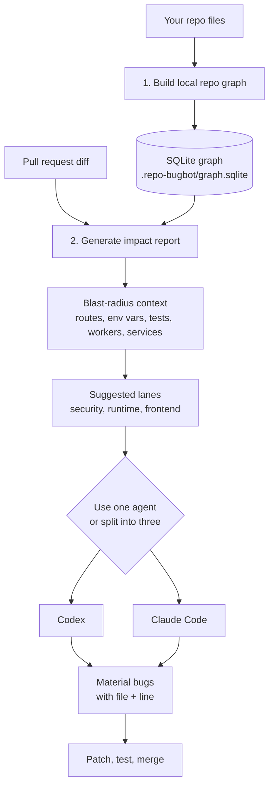

# Free Cursor Bugbot

A free local Bugbot-style reviewer for Codex and Claude Code.

Free Cursor Bugbot is for developers who like the idea of Cursor Bugbot, but already pay for coding agents like Codex or Claude Code.

Instead of paying for another review bot, Free Cursor Bugbot gives your existing agent the missing context:

- what changed
- what routes, env vars, tests, workers, and services are connected to it
- what production risks the PR touches
- what the agent should review first

Free Cursor Bugbot is independent and not affiliated with Cursor. "Bugbot-style" means PR diff in, blast-radius-aware review context out.

## Start Here

Clone the tool once:

```bash
git clone https://github.com/<owner>/free-cursor-bugbot.git
```

Then go to the app repo you want to review:

```bash
cd your-app-repo
python3 -m pip install -e /path/to/free-cursor-bugbot
repo-bugbot-index --repo . --db .repo-bugbot/graph.sqlite
repo-bugbot-impact --repo . --db .repo-bugbot/graph.sqlite --base origin/master --out .repo-bugbot/impact.md
```

Then paste this into Codex or Claude Code:

```text
Read .repo-bugbot/impact.md and git diff origin/master...HEAD.

Review this PR like a strict Bugbot pass. Only report material bugs with file and line references.

Focus on:
- impacted routes
- env vars
- workers/retries
- external writes
- billing/auth
- public UI
- missing tests for risky behavior

Do not report style-only issues.
```

That is the whole local workflow.

## How Many Agents Does It Spin Up?

Zero by default.

Free Cursor Bugbot does **not** automatically launch Codex, Claude Code, or paid agents. The CLI only creates local files:

```text
.repo-bugbot/graph.sqlite
.repo-bugbot/impact.md
.repo-bugbot/impact.json
```

The impact report includes **three suggested review lanes**:

1. Security, billing, and config
2. Runtime, data, and integrations
3. Frontend reachability and UX

You can use it three ways:

- **One agent:** give all of `.repo-bugbot/impact.md` to Codex or Claude Code.
- **Three agents:** split the three suggested review lanes across three Codex/Claude sessions.
- **Human review:** give the report to engineers as a PR review brief.

The simplest setup is one agent. The "three agents" path is optional when you want a heavier review.



## What Cursor Bugbot Does

Cursor Bugbot-style review is useful because it does not just say, "this line looks weird."

The workflow is more like:

1. Look at a pull request.
2. Understand what changed.
3. Guess what could break outside the changed lines.
4. Leave review comments on likely bugs.

That is the right idea. The problem is that many teams already pay for strong agents that can do the review if they are given the right context.

## Why Free Cursor Bugbot Exists

Codex and Claude Code are already good at code review.

What they usually lack is a clean map of the repository:

- which frontend file calls which backend route
- which route depends on which env var
- which worker can retry and duplicate a write
- which tests probably cover the touched code
- which Render service owns a config variable
- which public UI is actually mounted

Free Cursor Bugbot builds that map locally and gives it to the agent.

You are not paying for another brain. You are giving the brain you already pay for better context.

## How It Works

Free Cursor Bugbot has two commands.

### 1. Build The Repo Graph

```bash
repo-bugbot-index --repo . --db .repo-bugbot/graph.sqlite
```

This creates a local SQLite database:

```text
.repo-bugbot/graph.sqlite
```

The graph stores:

- files
- imports
- Python and TypeScript symbols
- FastAPI and Express-style routes
- env vars used by code
- Render services and env vars from `render.yaml`
- likely test relationships

Example:

```text
AdminPanel.tsx
  imports -> adminApi.ts

adminApi.ts
  calls -> /api/admin/reports

admin_router.py
  registers -> GET /api/admin/reports
  uses env -> SERVICE_API_KEY

render.yaml
  declares service -> app-api
  declares env -> SERVICE_API_KEY
```

### 2. Generate The PR Impact Report

```bash
repo-bugbot-impact --repo . --db .repo-bugbot/graph.sqlite --base origin/master --out .repo-bugbot/impact.md
```

This looks at the PR diff and asks:

- what files changed?
- what nearby files are connected?
- what env vars or routes were touched?
- what tests are probably relevant?
- is this a billing, auth, webhook, CRM, worker, or public UI risk?

The output is a markdown review brief:

```text
.repo-bugbot/impact.md
```

Give that file to Codex or Claude Code.

## Why This Is Useful

A normal diff review sees:

```text
changed: admin_router.py
```

Free Cursor Bugbot sees:

```text
changed: admin_router.py
also inspect: AdminPanel.tsx
also inspect: adminApi.ts
also inspect: render.yaml
also inspect: SERVICE_API_KEY
also inspect: tests touching admin routes
risk: route/auth/config boundary
```

That is the difference.

## Install From GitHub

```bash
python3 -m pip install git+https://github.com/<owner>/free-cursor-bugbot.git
```

Replace `<owner>` with the GitHub owner or organization where this repo is hosted.

## Use With Codex

Codex is good when you want review plus fixes.

Prompt:

```text
Use .repo-bugbot/impact.md and git diff origin/master...HEAD.
Find material bugs only.
If the fix is straightforward, patch it.
Then run the relevant tests.
```

Good Codex flow:

1. Generate `.repo-bugbot/impact.md`.
2. Ask Codex to review.
3. Approve real findings.
4. Ask Codex to patch.
5. Run the production gate.

## Use With Claude Code

Claude Code is good for long-form reasoning across a large PR.

Yes, this works with Claude Code. There is no special integration required. Free Cursor Bugbot writes normal local files into the same checkout:

```text
.repo-bugbot/graph.sqlite
.repo-bugbot/impact.md
.repo-bugbot/impact.json
```

Claude Code can read `.repo-bugbot/impact.md` and `git diff origin/master...HEAD` just like any other repo file.

Prompt:

```text
Read .repo-bugbot/impact.md and git diff origin/master...HEAD.
Act as a strict production code reviewer.
Prioritize bugs caused by impacted routes, env vars, workers, tests, external writes,
billing flows, and public UI.
Return findings ordered by severity.
```

## Optional Git Hook

Free Cursor Bugbot can refresh automatically after checkout, pull, or rebase:

```bash
git config core.hooksPath /absolute/path/to/free-cursor-bugbot/githooks
```

Disable temporarily:

```bash
REPO_BUGBOT_HOOKS=0 git pull
```

The hook is non-blocking. It does not call an agent and does not mutate your code. It only refreshes local files under `.repo-bugbot/`.

## What Is Free

The local version is free:

- local SQLite graph
- local impact reports
- local Git hooks
- Codex prompt
- Claude Code prompt
- no hosted service required
- no source upload required

## Possible SaaS Later

The local tool should stay useful on its own.

A paid SaaS version could add:

- GitHub PR comments
- hosted dashboards
- risk badges
- Slack alerts
- org-wide rules
- saved review history
- self-hosted enterprise deployment

But the core idea is simple: if you already pay for Codex or Claude Code, you should be able to run a strong Bugbot-style review locally.

## Status

Public alpha.

Still needed:

- CI
- better examples
- package releases
- more language/framework detection
